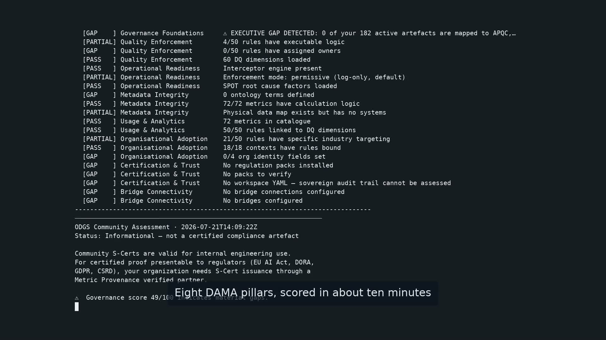
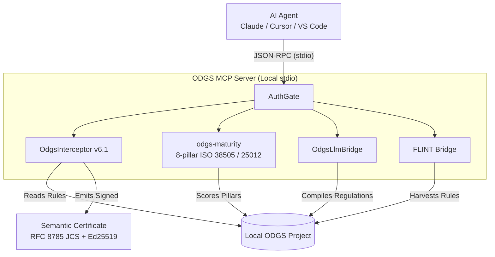

<!-- mcp-name: com.metricprovenance/odgs-mcp-server -->
# Open Data Governance Standard (ODGS) — MCP Server

> **Data that knows its own rules.** Deterministic `<2ms` governance enforcement and signed **Semantic Certificates** at the AI agent boundary.

[](https://mcprush.com/to/odgs-mcp?ref=badge)

[](https://www.metricprovenance.com/start)
[](https://modelcontextprotocol.io/)
[](https://pypistats.org/packages/odgs-mcp-server)
[](https://www.python.org/downloads/)
[](https://doi.org/10.5281/zenodo.18564270)
[](LICENSE)

---

Prompt rules drift. LLM-as-a-judge is still probabilistic. **`odgs-mcp-server`** connects any MCP-compatible AI agent (Claude Code, Claude Desktop, Cursor, VS Code, or custom agent loops) to the deterministic **ODGS v6.1** validation engine — halting rule breaches in under 2ms with zero LLMs in the enforcement path and issuing RFC 8785 JCS + Ed25519 **Semantic Certificates** (`S-Cert`).

> **For engineers:** [Quick Start](#quick-start) · [Guided Walkthrough](https://www.metricprovenance.com/start)  
> **For executives & compliance teams:** [Executive Briefing](https://www.metricprovenance.com/executive-brief) · [Free Browser-Local Board Charter Diagnostic](https://charter.metricprovenance.com)

### See it in action

[](docs/demo/clip_mcp.mp4)

Eight ISO/IEC 38505-1 & ISO/IEC 25012 pillars scored locally — real MCP server, real maturity engine, zero data leaving your machine.

---

> [!IMPORTANT]
> **ODGS MCP Server v0.4.0 — Open-Source Community Tier + Certified Packs**
> The community tier — `validate_payload`, `validate_batch`, `governance_score`, `conformance_check`, `list_packs`, and `server_status` — is **Apache 2.0 and completely free with no registration**.
> Regulatory compilation, semantic drift detection, and enterprise catalog synchronisation require a Metric Provenance Certified Pack licence.

---

## Quick Start

```bash
# Core validation & Semantic Certificates (free, no account needed)
pip install odgs-mcp-server

# Recommended: include 8-pillar ISO/IEC 38505-1 & 25012 maturity scoring
pip install odgs-mcp-server odgs-maturity

# Full install with LLM bridge support
pip install "odgs-mcp-server[llm]"
```

### Client Configuration (stdio transport)

<details open>
<summary><b>Claude Code (1-Line CLI)</b></summary>

```bash
claude mcp add odgs-governance -- odgs-mcp-server --transport stdio
```
</details>

<details>
<summary><b>Claude Desktop</b></summary>

Add to `claude_desktop_config.json`:
```json
{
  "mcpServers": {
    "odgs-governance": {
      "command": "odgs-mcp-server",
      "args": ["--transport", "stdio"],
      "env": {
        "ODGS_PROJECT_ROOT": "/path/to/your/odgs/project"
      }
    }
  }
}
```
</details>

<details>
<summary><b>Cursor / VS Code (`.cursor/mcp.json` or `.vscode/mcp.json`)</b></summary>

```json
{
  "mcpServers": {
    "odgs-governance": {
      "command": "odgs-mcp-server",
      "args": ["--transport", "stdio"],
      "env": {
        "ODGS_PROJECT_ROOT": "/path/to/your/odgs/project"
      }
    }
  }
}
```
</details>

### Try It in 30 Seconds (Paste Into Claude / Cursor)

> *"Run `governance_score` on this workspace across the 8 ISO/IEC 38505-1 & ISO/IEC 25012 pillars, then call `validate_payload` on a sample financial metric and return the signed Semantic Certificate."*

---

## Tools Reference

### Community (Free · Apache 2.0 · Zero Registration)
| Tool | Description |
|:---|:---|
| `validate_payload` | Validate a data payload against ODGS rules in `<2ms` and emit a signed Semantic Certificate |
| `validate_batch` | Gate multiple payloads in a single deterministic call |
| `governance_score` | Score governance maturity (0–100) across 8 ISO/IEC 38505-1 & 25012 pillars with per-pillar gap analysis |
| `conformance_check` | Run ODGS L1/L2 protocol conformance self-check |
| `list_packs` | List available Certified Regulation Packs |
| `server_status` | Return active server version, tier, installed engines, and project root diagnostics |

### Professional (API Key Required)
| Tool | Description |
|:---|:---|
| `download_pack` | Download and cache certified regulatory rule packs locally |
| `compile_regulation` | Convert statutory text (EU AI Act, DORA, GDPR, CSRD) into validated ODGS rule JSON |
| `check_drift` | Detect semantic drift in governance definitions across versions |
| `detect_conflicts` | Identify contradictions between overlapping regulatory rules |
| `narrate_audit` | Convert a Semantic Certificate into a plain-English executive audit summary |
| `discover_bindings` | Propose physical schema-to-rule mappings from catalog metadata |

### Enterprise (API Key Required)
| Tool | Description |
|:---|:---|
| `harvest_sovereign_rules` | Extract and mint rules from enterprise data stores via the FLINT bridge (**preview**) |

---

## Architecture

The ODGS MCP Server runs **100% locally and zero-trust**. Validation happens strictly inside your environment — raw enterprise data never leaves your perimeter.



---

## EU AI Act, DORA & Certified Regulation Packs

Organisations operating High-Risk AI Systems under **EU AI Act Articles 10 & 12** (enforced **2 December 2027**) require verifiable data governance at the pipeline and agent boundary. Semantic Certificates provide a tamper-evident first-party audit record exporting natively to **W3C PROV-O**, **NIST OSCAL**, and **Eclipse CAP v2.2.1**.

| Pack | Regulation | Status |
|:---|:---|:---|
| **EU AI Act** | Regulation (EU) 2024/1689 | ✅ Certified |
| **DORA** | Digital Operational Resilience Act | ✅ Certified |
| **GDPR** | General Data Protection Regulation | ✅ Certified |
| **CSRD** | Corporate Sustainability Reporting Directive | ✅ Certified |
| **NIS2** | Network and Information Security Directive | ✅ Certified |
| **Basel III** | Basel Committee on Banking Supervision | ✅ Certified |

*Enterprise rollout & certified packs: [metricprovenance.com/executive-brief](https://www.metricprovenance.com/executive-brief)*

---

## Environment Variables

| Variable | Description | Default |
|:---|:---|:---|
| `ODGS_PROJECT_ROOT` | Path to local ODGS governance definitions | Current directory |
| `ODGS_API_KEY` | Optional API key for Professional/Enterprise tools | None (Community tier) |
| `ODGS_CACHE_DIR` | Local cache directory for downloaded packs | `~/.odgs/cache` |
| `ODGS_REGISTRY_URL` | Optional custom/enterprise registry endpoint | Enterprise default |

---

## Links & Ecosystem

- **Open Protocol Specification (Apache 2.0):** [github.com/MetricProvenance/odgs-protocol](https://github.com/MetricProvenance/odgs-protocol) (`pip install odgs`)
- **PyPI Package:** [pypi.org/project/odgs-mcp-server](https://pypi.org/project/odgs-mcp-server/)
- **MCPRUSH Listing (Grade A):** [mcprush.com/metricprovenance/odgs-mcp](https://mcprush.com/metricprovenance/odgs-mcp)
- **Permanent Archive (Zenodo DOI):** [10.5281/zenodo.18564270](https://doi.org/10.5281/zenodo.18564270)
- **Free Browser-Local Board Charter Diagnostic:** [charter.metricprovenance.com](https://charter.metricprovenance.com)
- **Executive Briefing:** [metricprovenance.com/executive-brief](https://www.metricprovenance.com/executive-brief)

## Licence

Apache 2.0 — see [LICENSE](LICENSE).  
The protocol engine and MCP server are open source. Certified Regulation Packs and the air-gapped enterprise suite are offered commercially by **Metric Provenance** (`partner@metricprovenance.com`).
